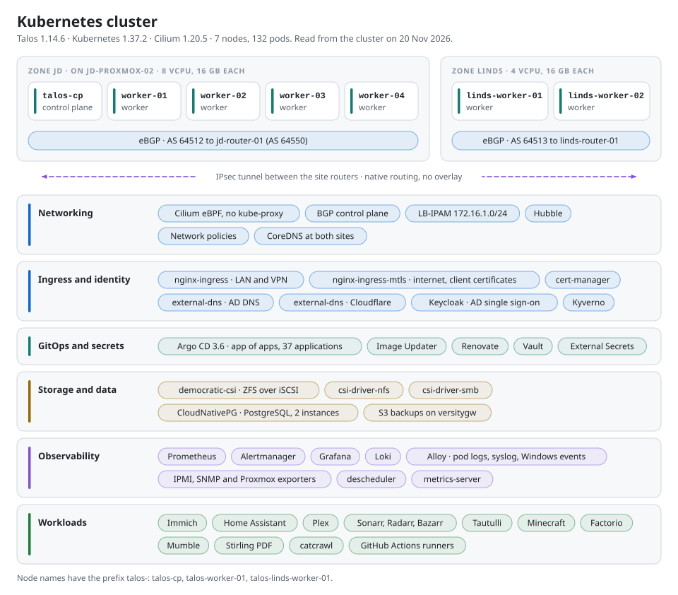
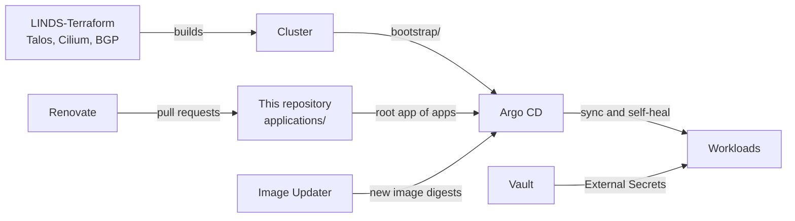
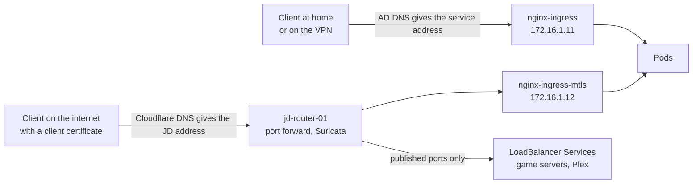

# LINDS Kubernetes Homelab

This repository holds the configuration of my personal Kubernetes homelab. One **Talos Linux** cluster runs on **Proxmox VE** at two sites. The focus is fast networking, GitOps and automation.

<picture>
  <source media="(prefers-color-scheme: dark)" srcset="img/cluster-dark.svg">
  
</picture>

The network and the hardware under the cluster are on [jayden-lind.github.io/homelab](https://jayden-lind.github.io/homelab/).

## Cluster Overview

* **Nodes:** 1 control plane and 4 workers at JD, 2 workers at LINDS. Each node has the label `topology.kubernetes.io/zone` (`jd` or `linds`).
* **OS:** Talos Linux on Proxmox VE
* **Networking:** [Cilium](https://cilium.io/) with the **eBPF dataplane**, native routing and the **BGP control plane**. The nodes of each site peer with that site's Debian router (FRR). Hubble shows the flows.
* **Service Load Balancing:** Cilium LB-IPAM (`172.16.1.0/24`) advertised over BGP, no MetalLB
* **Proxy:** kube-proxy is **disabled**. Cilium's kube-proxy replacement does the service load balancing.
* **Storage:** ZFS on the JD Proxmox host. [democratic-csi](democratic-csi/) makes an iSCSI volume for each claim (`zfs-iscsi`). Shared data comes over NFS (`nfs-csi`) and SMB.
* **Databases:** [CloudNativePG](postgresql/README.md), with WAL archive and base backups to S3
* **GitOps:** [Argo CD](https://argo-cd.readthedocs.io/) provisions and manages all applications
* **Monitoring:** Prometheus, Alertmanager, Grafana, Loki and Alloy. They also watch the routers, the hypervisors and the Windows servers ([monitoring-hardware/](monitoring-hardware/README.md)).

The versions are in code: Talos, Kubernetes and Cilium in [LINDS-Terraform](https://github.com/Jayden-Lind/LINDS-Terraform/tree/main/proxmox), the charts in [`applications/`](applications/). Renovate opens a pull request for each new release.

## Bootstrap

After building the cluster with [Terraform](https://github.com/Jayden-Lind/LINDS-Terraform/blob/main/proxmox/talos.tf), the cluster is hydrated with three `kubectl` commands:

```bash
# 1. Vault bootstrap token for External Secrets (gitignored - not in this repo)
kubectl apply -f linds-secret.yml

# 2. Install Argo CD (pinned version + config baked in via kustomize)
kubectl apply --server-side -k bootstrap/

# 3. Create the root app-of-apps - Argo CD takes over from here
kubectl apply -f applications/root.yaml
```

The [root Application](applications/root.yaml) syncs everything in [`applications/`](applications/), which includes [Argo CD itself](applications/argocd.yaml) (self-managed from [`bootstrap/`](bootstrap/)). Adding a new app is just committing a new `Application` manifest to `applications/` — no manual `kubectl` needed. Argo CD upgrades are done by bumping the pinned version in [`bootstrap/kustomization.yaml`](bootstrap/kustomization.yaml).

## From a commit to a running pod



* **Argo CD** manages all workloads, applications, monitoring, logging, and supporting services.
* **Exception:** Cilium (Helm release, BGP peering and the LB IP pool) is managed from [LINDS-Terraform](https://github.com/Jayden-Lind/LINDS-Terraform/tree/main/proxmox) next to the Talos machine configs, because the CNI has to exist before Argo CD can run.
* **Secrets** stay in Vault. External Secrets copies them into the cluster. No secret is in this repository.
* **Updates:** [Renovate](renovate.json5) opens pull requests for charts and pinned images. Argo CD Image Updater follows the images that are tracked by digest ([image-updates/](image-updates/)).

## How traffic reaches a service



* Cilium gives each `LoadBalancer` Service an address from `172.16.1.0/24` and advertises it to the routers over BGP. The address is reachable from both sites and from the VPN.
* `external-dns` writes the internal name to the AD DNS zone. Clients at home go directly to the Service.
* Nothing is public by default. A Service or an Ingress becomes public only with the `public.linds.com.au/*` annotations: the router then forwards the port, and `external-dns-public` writes the name to Cloudflare. See [docs/publish-a-service.md](docs/publish-a-service.md).
* Web applications that are public use the `nginx-mtls` ingress class. It refuses a connection that has no valid client certificate. See [nginx-ingress-mtls/](nginx-ingress-mtls/README.md).

## Key Features

* **eBPF dataplane:** Improves performance and observability, removes the need for kube-proxy.
* **BGP integration:** Cilium peers with the router of each site, advertising pod CIDRs, ClusterIPs and LoadBalancer IPs for seamless external access.
* **Declarative GitOps:** All apps are managed through Git with Argo CD, enabling full reproducibility and rollback.
* **mTLS-only ingress:** A dedicated ingress class for publishing services to the internet behind client-certificate auth — see [nginx-ingress-mtls/](nginx-ingress-mtls/README.md).
* **AD-backed SSO:** Keycloak federates users and groups read-only from the `linds.com.au` Active Directory over LDAPS, and fronts the services that speak OIDC/SAML natively — see [keycloak/](keycloak/README.md).
* **Two sites, one cluster:** Workloads can be pinned to a zone or spread across both. The descheduler keeps the spread after a node restart.

## Runbooks

* [Publish a service to the internet](docs/publish-a-service.md)
* [PostgreSQL restore drill](docs/postgres-restore-drill.md)
* [iSCSI volume mount failures](docs/iscsi-pvc-mount-failures.md)
* [Storage tuning at JD](docs/jd-storage-tuning.md)

---

This setup prioritizes clean GitOps workflows, minimal moving parts, and high-performance networking using Cilium.
